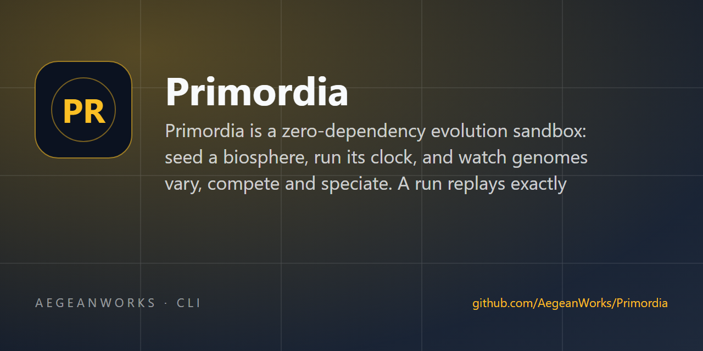

# primordia

<!-- aegean:media:start -->
<p align="center"></p>
<p align="center"><a href="LICENSE"></a> <a href="https://github.com/AegeanWorks/AIKit"></a></p>
<!-- aegean:media:end -->


Primordia is a zero-dependency evolution sandbox: seed a biosphere, run its clock, and watch
genomes vary, compete and speciate. A run replays exactly from its seed, and a fossil record
keeps the story of what happened.

> **Status**: v1.0.6 - all six milestones are in: the genome model, the seasonal world and the
> deterministic engine, phenetic species with a fossil record, atomic saves and a command line,
> and the web observatory with interactive phylogenetic cladograms, ecology time-series charts,
> lineage drift readings, and six god-mode shocks; post-release audits hardened configs, saves,
> the filesystem edges, the observatory's request handling, the simulation's neighbour
> bookkeeping and blocked steps, and the round-trip, intervention-input and snapshot-date
> contracts.

## ⚡ 30-Second Cold-Start Quick Reference

- **Runtime Prerequisites**: Python 3.10+ (standard library only - zero third-party packages) and git.
- **Canonical Regression Shield Gate**:
  ```bash
  python aikit.py check primordia
  ```

### 🛠️ AIKit Commands (run from the AIKit folder)
| Role | Command |
|---|---|
| Status, task and gates | `python aikit.py status primordia` |
| Phase 4: every gate | `python aikit.py check primordia` |
| Repair memory and map, then check | `python aikit.py fix primordia` |
| Resume an interrupted task | `python aikit.py resume primordia` |

## 📦 What's Inside

```text
primordia/
├── .aikit/                   <- project memory: record, ledger, decisions, map
├── .gitignore                <- transient AIKit state and Python caches excluded
├── LICENSE                   <- Aegean License 1.1 (AL-1.1): free personal use
├── LICENSES/                 <- REUSE license texts
├── REUSE.toml                <- Machine-readable SPDX metadata
├── README.md
├── COMMERCIAL.md
├── pyproject.toml            <- build, package configuration and the `primordia` script
├── primordia/                <- core package
│   ├── __init__.py           <- package metadata
│   ├── __main__.py           <- `python -m primordia` entry point
│   ├── analytics.py          <- population statistics: counts by species, mean traits
│   ├── cli.py                <- the command line and the interactive shell
│   ├── creature.py           <- one genome plus the engine's mutable per-tick state
│   ├── engine.py             <- the deterministic tick loop
│   ├── fossil.py             <- the fossil record: sightings, peaks and events per species
│   ├── genome.py             <- bounded genes and variation operators
│   ├── save.py               <- versioned atomic saves and corrupt-file recovery
│   ├── shocks.py             <- god-mode interventions: meteor, bloom, cull, introduce, ice_age, radiation_burst
│   ├── species.py            <- phenetic species: genomes cluster by genetic distance
│   ├── web.py                <- the observatory: cladogram, trends charts, local web view
│   └── world.py              <- tile grid, food layer and temperature field
└── tests/                    <- unit test suite
    ├── __init__.py
    ├── test_analytics.py     <- species counts and trait means
    ├── test_cli.py           <- run, resume, stats and the interactive shell
    ├── test_engine.py        <- determinism, invariants and behavioural mechanics
    ├── test_fossil.py        <- censuses, extinction and the bounded event log
    ├── test_genome.py        <- gene bounds, mutation, crossover and distance
    ├── test_save.py          <- round trips, atomic writes and backup recovery
    ├── test_species.py       <- classification, ancestry and monotone species ids
    ├── test_web.py           <- payload, dashboard, god-mode shocks and a socket smoke
    └── test_world.py         <- terrain, food and temperature
```

## 🧬 The Genome

A genome is twelve genes normalized to [0, 1]; the engine decodes them into physical traits.
Variation operators never leave the declared ranges, and every random draw comes from one
injected `random.Random`, so `same seed => same history` is a contract the tests replay.

| Gene | What it steers |
|---|---|
| `size` | body size: more energy capacity and defense, higher upkeep |
| `speed` | tiles moved per tick, paid for in energy |
| `metabolism` | metabolic efficiency: slow burn versus fast burn |
| `diet` | foraging mode: 0 grazes plants, 1 hunts other creatures |
| `sense` | perception radius for food, threats and mates |
| `aggression` | readiness to attack rather than avoid a neighbor |
| `social` | attraction to kin and crowds versus solitude |
| `fecundity` | offspring per successful reproduction |
| `lifespan` | resistance to aging and starvation damage |
| `thermophily` | preferred temperature band of the world |
| `curiosity` | wandering drive versus staying put in plenty |
| `mutability` | own mutation rate: how far its children may stray |

## 🌍 The World & The Engine

The world is a tile grid of land and water. Every land tile carries a food layer that starts as
standing biomass, then regrows with the season (each tile on its own phase, so booms and famines
travel across the map), under a temperature field that drifts between a north-south gradient and
the seasonal sine.

One engine tick is one fixed sequence: the world updates first, then every creature acts in
ascending cid order. A creature pays upkeep (size, speed, metabolism, temperature mismatch),
ages, and either forages while it is below breeding condition - hunting the weakest reachable
weaker neighbour when its genes allow, otherwise grazing the best tile it can sense, its stock
discounted by the walk, so it grazes where it stands when local food is good instead of herding
onto one maximum - or reproduces when a compatible mate is near, or wanders. Attacks are
softened by a comparable body (armor), movement is one tile per stride with a second stride
rolled against speed, and a dead body returns to the soil as food for the next generation. A
blocked direct step waits or takes the other axis; it never turns into a sidestep.

Determinism is the contract: every random draw comes from one seeded `random.Random` in a fixed
order, so the same seed replays the same history exactly - a property the suite checks by
comparing full-state hashes that include the raw RNG, climate, species and fossil state. The
neighbour hash is rebuilt at the start of each tick and updated whenever a creature moves, dies
or is born, so every interaction is resolved against actual positions rather than the positions
held when the tick began.

## 🦕 Species & The Fossil Record

A species is phenetic: the registry keeps each lineage's founding genome, and a new genome joins
the nearest species when it lies within `SPECIATION_DISTANCE` of that founder; beyond it, the
drifting lineage founds a new species and names its ancestor. Species never merge, so ids stay
monotone and the record is a tree. The founders themselves are one ancestral species - a
template drawn from the survivable ranges of the cost genes, jittered per founder - so evolution
starts with real variance inside one lineage. The template itself is the species founder, so
the jittered herd is always one species: every offset is at most 0.15 per gene, well inside the
0.18 speciation distance.

Drift is the observable side of that rule: for every living lineage the analytics read the
mean and worst `genetic_distance` from its founding genome, so a lineage's distance can be
reported as a share of `SPECIATION_DISTANCE` (0.18) before it splits. A creature counts as
*near* the threshold when it reaches 80% of that distance, and each lineage also reports its
herbivore/carnivore split and mean age, so a radiation is legible while it happens rather than
only after a new species appears in the fossil record.

Each tick the engine censuses the living population. The fossil record keeps one trace per
species (first and last seen, peak population, extinction tick) plus a bounded event log of
speciations and extinction episodes; the counters stay monotone even when the window forgets an
old event, so a long run costs bounded memory and still tells its whole story. An extinction
episode is one census miss, and a species that reappears clears its date and can end again -
the counter counts moments, not gravestones.

## 💾 Saves & The Command Line

```bash
python -m primordia run --seed 7 --ticks 500 --save world.json
python -m primordia resume world.json --ticks 500     # continues and saves in place
python -m primordia stats world.json                  # report without stepping, with lineage drift
python -m primordia repl world.json                   # interactive shell
```

A save is one versioned JSON snapshot: the world's layers, every creature, the species
registry, the fossil record and the raw state of the engine's `random.Random`. Resuming replays
the same future the uninterrupted run would have had, and the suite proves it by comparing
state hashes across a save/load boundary. Writes are atomic - a temp file is fsynced, the old
save rotates to `.bak` and `os.replace` moves the new file in with retries - a corrupt file is
quarantined while its `.bak` takes over, a save written by a different save version is refused
with a clear error and left untouched, a missing primary with a live `.bak` restores itself,
and every failure carries a `Why:` and a `Fix:` line with exit codes 0, 1 and 2. A snapshot is
verified before it is trusted: layer sizes, terrain and climate ranges, unique creature ids,
in-bounds land positions, species references, finite numbers, ages inside the run and fossil
dates inside the snapshot must all hold, or the file is treated as corrupt rather than crashing
or lying about the next tick. The species threshold travels with the save, and files written
before it did load at the default 0.18. Filesystem mistakes are refused before
anything moves: a path that is a folder is never renamed away, and reading one, a file without
a save version, or a save whose quarantine cannot move it all end in a readable `SaveError`
rather than a traceback. The shell answers `step [N]`, `stats`, `species [N]`, `fossil [N]`,
`hash`, `save PATH`, `help` and `quit`; every report also names the lineage closest to
speciation, and each `species` row carries its drift against the threshold, how many of its
creatures are near it, its herbivore/carnivore split and its mean age. `pip install .` also
installs the same commands as a `primordia` script.

## 🔭 The Web Observatory

```bash
python -m primordia web --seed 7 --ticks 500      # then open http://127.0.0.1:8000
```

The observatory is a standard-library-only server rendering one world: a food-shaded map with
every creature dotted in its lineage's colour, the population and fossil counters, the species
table with each lineage's drift, near-threshold count and diet split, and the recent fossil
events. `?step=N` advances the clock before rendering and
`?step=N&auto=S` adds a meta refresh so a tab can watch a world live; `/state.json` serves the
same facts as data, `/history.json` serves the recorded time-series trend history, and `/save`
downloads the standard save file.

Below the map, the observatory renders two rich vector views:
1. **Ecology Trends & Population History**: inline SVG charts tracking total population, living
   species counts, and five key trait trajectories (`diet`, `size`, `speed`, `metabolism`,
   `thermophily`) across recent simulation ticks.
2. **Interactive Phylogenetic Cladogram**: an SVG cladogram rendering the complete branching
   tree of all lineages ever founded, color-coded by lineage hue, with visual distinctions
   between living and extinct species, birth ticks, and rich tooltip metadata.

God mode provides six interventions - `meteor` (burn a disc of food and everyone in it), `bloom`
(feed a disc), `cull` (thin the weakest share), `introduce` (release near-clones of the
ancestral lineage), `ice_age` (chills land food across the grid and imposes thermophily stress),
and `radiation_burst` (irradiates a share of living creatures, inducing mutations and speciation).
Each one mutates only state the engine already carries, so a shocked world still saves, loads and
resumes exactly. When given a save file, the observatory writes the operator-driven changes -
a `--ticks` pre-roll, session steps and shocks - back to it when the server exits, and leaves an
untouched save alone. A malformed, negative or oversized `Content-Length` is answered with the
400 refusal page instead of a crashed or hung request, a port the OS refuses becomes a readable
error asking for another one, and binding beyond loopback prints a warning that the mutating
server has no authentication.

## 🧪 Development

The unit suite runs with:

```bash
python -m unittest discover
```

151 tests replay fixed seeds: gene bounds and seeded reproducibility for the variation
operators; terrain, standing biomass, growth and temperature invariants plus config validation,
including non-finite and non-integer inputs, for the world; classification, ancestry and
monotone ids for the species registry; censuses, extinction and the bounded event log for the
fossil record; population statistics and lineage drift metrics (mean and worst distance to the
founder, near-threshold counts, diet split, mean age); exact save round trips, atomic writes, backup recovery,
version-drift refusal, crash-window recovery, folder/quarantine edges and snapshot-shape
verification for persistence; empty-world and dead-world resilience for the engine; run,
resume, stats, the version flag, session persistence, reports under a zero speciation
threshold and the interactive shell for the command line; payload, dashboard rendering, disc
geometry for god-mode shocks, request body
validation, bind failures, real-socket smoke, full lineage payloads, phylogenetic cladograms,
and time-series trend SVG charts for the observatory; byte-identical replays of the same seed,
live neighbour bookkeeping, staged grazing and hunting mechanics, armored-defense arithmetic,
a drift-to-speciation run, a blocked direct step that never sidesteps, integer-energy and
custom-threshold round trips, typed shock inputs, refused snapshot dates and a performance smoke test.

<!-- aegean:brand-assets:start -->
## 🎨 Brand Assets

> **AI-Generated Brand Artwork.** The banner and logo are **AI-generated brand assets**. They are illustrative and may not literally depict every feature or the full project scope.
<!-- aegean:brand-assets:end -->

## 📜 License

Free for personal use under the Aegean License 1.1 (AL-1.1); see [LICENSE](LICENSE). Any commercial use needs the Aegean Commercial License 1.0 (ACL-1.0); see [COMMERCIAL.md](COMMERCIAL.md).
